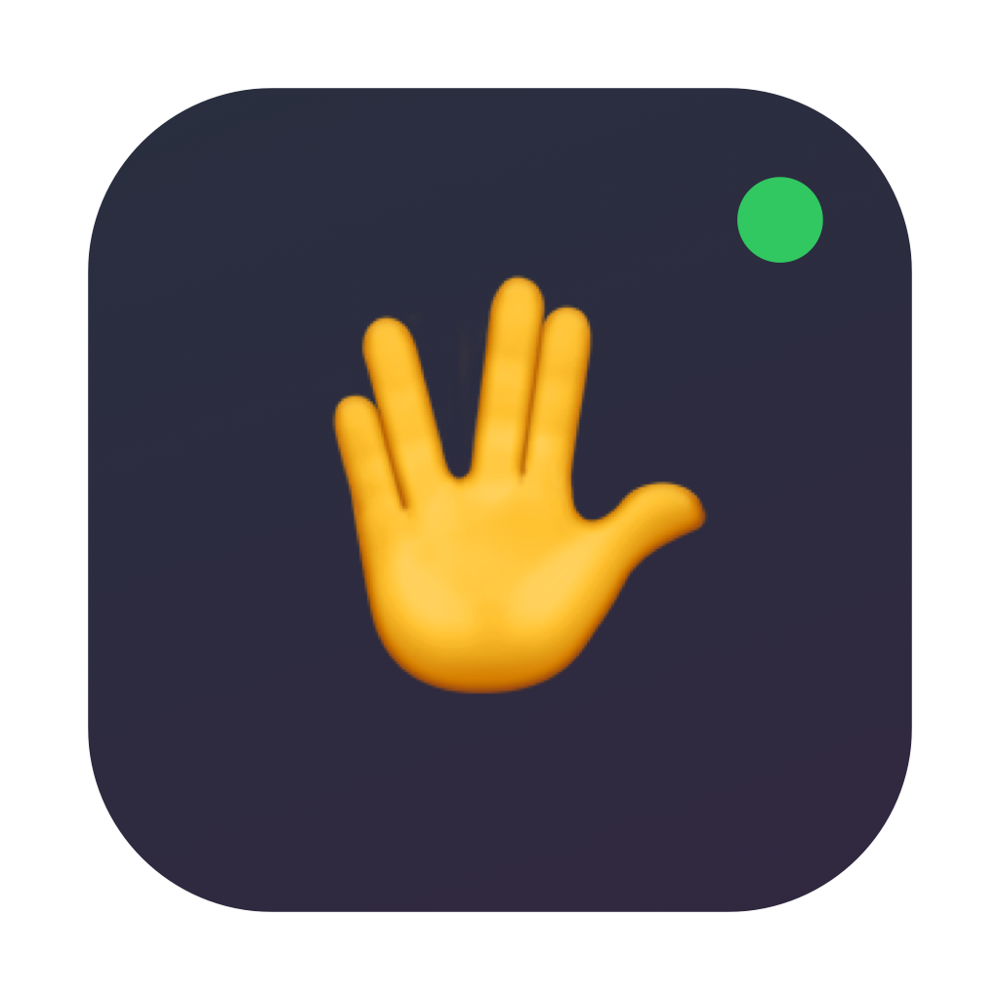

# 顺手 Shunshou

**macOS 菜单栏小工具箱**

汇能于一 · 简去冗杂 · 应手而生

[官网](https://llit.cn/shunshou/)

---

围绕「简便」的 Mac 小工具合集：菜单栏常驻，点开即用，不用不打扰。原生 Swift 编写，本地优先，全程离线的功能不联网。

## 功能一览（开发中）

| 功能 | 说明 |
|---|---|
| 📷 截图标注 | ⌥A 框选 → 矩形/椭圆/箭头/画笔/文字/马赛克标注，回车即复制、可另存；支持长截图、贴图钉桌面 |
| 🔍 OCR 提字 | ⌥S 框选提字，中英文识别，可编辑卡片 |
| 🌐 一键翻译 | 提字直接翻：系统翻译引擎 / 自定义翻译接口，逐段原文译文对照 |
| 🎙️ 语音输入 | 全程本地离线识别，双模型可切（极速/精准），说完直接打进光标处，支持词表纠错 |
| 🪟 贴边收纳 | 窗口拖到屏幕边缘收成小把手，碰边滑出，拖出自动解除 |
| 📋 剪贴板历史 | ⌘⇧V 呼出，搜索过滤、重复内容自动置顶 |
| 🚀 快捷启动 | 热键直达指定 app，支持连按两下与多目标冲突选择 |
| 🗜️ 图片工具 | 本地压缩 png/jpg/webp/heic/gif + 五种格式互转 |
| 📁 查找大文件 | treemap 方块图 + 树形列表 + Top 100 排行，空间去哪儿了一目了然 |

> 以上功能均在开发中，将随版本逐步放出。

## 编译

- 要求：macOS 15+，Swift 5.9
- `swift build -c release`
- 语音功能依赖 sherpa-onnx 静态库（拉取方式后续补充）

## 关于

- 作者：LLITGQ（[github.com/llitgq](https://github.com/llitgq)）
- 微信：SDCEWAN
